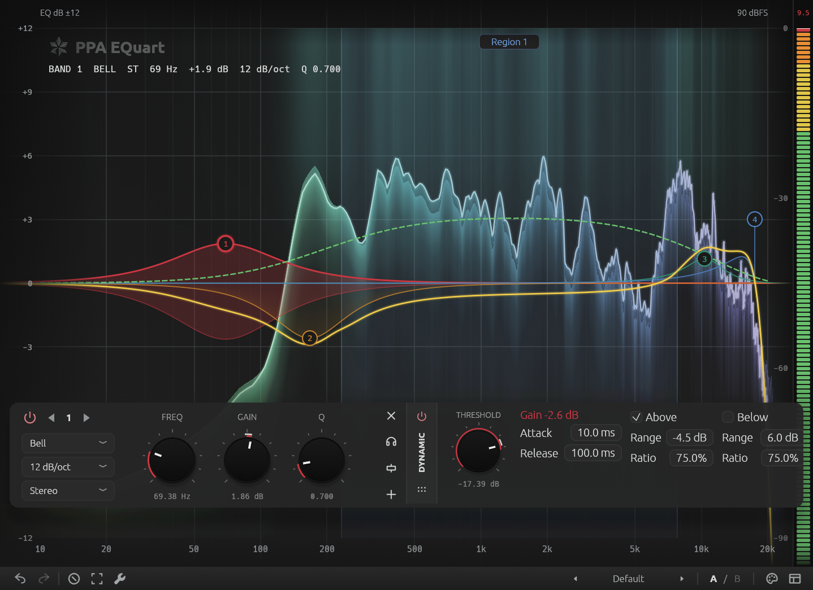

# PPA EQuart

Parametric EQ by Phosphorus Audio, built with [nice-plug](https://codeberg.org/RustAudio/nice-plug) (VST3 & CLAP).



## downloads

[GitHub Releases](https://github.com/Phosphorus-Audio/EQuart/releases) provides CLAP
and VST3 for Windows x64, macOS Universal, and Linux x64. The macOS release also
includes a self-contained Audio Unit (AUv2) for Logic Pro and other AU hosts (macOS 14 or newer is required)

## features

EQuart combines a 32-band parametric EQ with six spectral regions, dynamic EQ, pitch tracking, harmonic and resonance processing, parameter mapping, tempo-synced LFOs, dual Response routing, and configurable spectral dynamics. It supports Zero Latency, Natural Phase, and Linear Phase processing, 32/64-bit DSP, sidechain input, input/output spectrum analysis, heatmaps, presets, A/B comparison, and 100-step undo/redo.

## performance

Static SVF sections run on an AVX2 block kernel (8 frames at a time via short convolution + state fixup) 

But! If something changes a parameter (like dragging a knob or running automation), it falls back to per-sample processing only while it's moving.

`cargo test --release bench_engine_throughput -- --ignored --nocapture` (48 kHz stereo, best of 5 runs):

The performance test data looks kind of sketchy, so I left it out

Oversampling latency: 0 frames (1x), 32 frames (2x), 48 frames (4x).

## building

Needs Rust and native build tools (MSVC on Windows). Windows UI uses wgpu / D3D12 (no OpenGL fallback).

```powershell
cargo xtask bundle equart --release
```

Outputs `target/bundled/equart.clap` and `target/bundled/equart.vst3/`. (`build.bat` / `build.sh` wrap this too.)

To build the macOS Universal AU, install both Rust macOS targets, CMake, and Xcode
command line tools, then run:

```sh
MACOSX_DEPLOYMENT_TARGET=14.0 cargo xtask bundle-universal equart --release --locked
python3 tools/ci/build_au.py
```

This creates `target/bundled/equart.component` with its own embedded CLAP engine.
Install it in `~/Library/Audio/Plug-Ins/Components/` or use the release PKG.

With `dpi-trace` enabled, frame stats log to `%LOCALAPPDATA%\f0lock\diagnostics\`:

```powershell
cargo xtask bundle equart --release --features dpi-trace
```

Standalone app (for testing without a DAW):

```powershell
cargo run --release --features standalone -- --help
```

For debug builds with a fake pink noise signal (when you have no audio backend):

```powershell
mkdir target; New-Item target/test-signal
cargo run --features standalone
```

Delete `target/test-signal` to go back to real audio.


## credits

- [nice-plug](https://codeberg.org/RustAudio/nice-plug)
- [Cytomic: Linear Trapezoidal Integrated SVF](https://www.cytomic.com/files/dsp/SvfLinearTrapOptimised.pdf)
- [f0lock](https://github.com/sout233/f0lock) — SVF coeffs, cut cascade, analyser, spectrum, knobs, dynamic EQ detector
- [CamillaDSP](https://github.com/HEnquist/camilladsp) — RBJ biquad formulas for just tests maybe (why? just add a Fruity Parametric EQ 2 and see its ref)
- [lsp-dsp-units](https://github.com/sadko4u/lsp-dsp-units) — Butterworth pole/Q math
- [ZLEqualizer](https://github.com/ZL-Audio/ZLEqualizer) — just multi-section cascade reference
